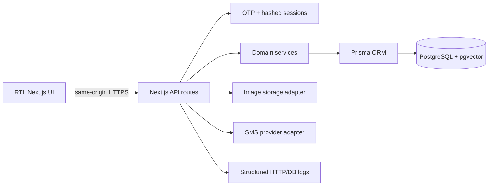

# Architecture

## Runtime data flow

## Boundaries

- `src/app/**/page.tsx` contains presentation and server-side page composition.
- `src/app/api/**` validates external input, checks authentication, and returns JSON.
- `src/lib/` contains domain services and adapters; database access is centralized through Prisma.
- PostgreSQL is the source of truth for users, sessions, profiles, listings, and interactions.
- Image and SMS providers are external adapters configured only through environment variables.

## Request security

Mutating API requests must include a same-origin `Origin` or `Referer`. Sessions use a random bearer token stored only in an HTTP-only, SameSite cookie; only its SHA-256 hash is persisted. A successful OTP login revokes prior sessions for that user before issuing a new token.

## Threat model

| Asset | Threat | Control |
| --- | --- | --- |
| Session cookie | XSS/session theft and CSRF | HTTP-only/SameSite cookie, security headers, same-origin mutation checks |
| OTP challenge | Guessing and replay | Hash at rest, five-minute expiry, one-time consumption, request rate limit |
| Seller listings | Unauthorized edits | Authenticated seller ownership checks in domain services |
| Uploaded images | Malware, oversized files, unsafe storage | MIME/size validation, generated filenames, production remote-storage requirement |
| Provider credentials | Accidental disclosure | Environment-only configuration, Gitleaks CI, no secrets in logs |
| Personal data | Excessive observability exposure | Structured logs exclude query text, tokens, request bodies, and phone numbers |

## AI evaluation

The current recommendation system is deterministic and rule-based. Every ranking change should be evaluated against a fixed fixture containing category, color, size, budget, and freshness matches. Track:

- ranking precision at 5 and 10;
- budget-violation rate;
- category and size match rate;
- cold-start behavior when no profile exists;
- latency and error rate for feed requests.

Embedding-based ranking remains a separate phase and must ship with offline fixtures, a rollback path, and privacy review before activation.
